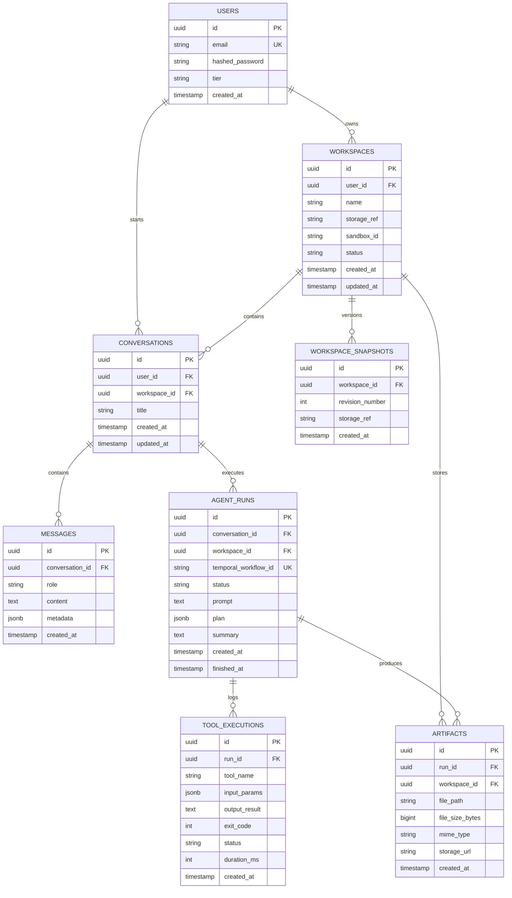

# API Contracts & Database Schema Specification

## 1. Database Architecture (PostgreSQL)

Spark uses **PostgreSQL 16+** as its authoritative relational data store. It maintains user accounts, workspace definitions, conversation histories, agent execution metadata, tool audit logs, and generated artifacts.

### Entity-Relationship Diagram



---

## 2. PostgreSQL Relational DDL

```sql
-- Enable UUID extension
CREATE EXTENSION IF NOT EXISTS "uuid-ossp";

-- 1. Users Table
CREATE TABLE users (
    id UUID PRIMARY KEY DEFAULT uuid_generate_v4(),
    email VARCHAR(255) UNIQUE NOT NULL,
    hashed_password VARCHAR(255) NOT NULL,
    tier VARCHAR(50) NOT NULL DEFAULT 'standard', -- standard, pro, enterprise
    created_at TIMESTAMP WITH TIME ZONE DEFAULT CURRENT_TIMESTAMP,
    updated_at TIMESTAMP WITH TIME ZONE DEFAULT CURRENT_TIMESTAMP
);

-- 2. Workspaces Table
CREATE TABLE workspaces (
    id UUID PRIMARY KEY DEFAULT uuid_generate_v4(),
    user_id UUID NOT NULL REFERENCES users(id) ON DELETE CASCADE,
    name VARCHAR(255) NOT NULL,
    storage_ref VARCHAR(512) NOT NULL,            -- Mount path or volume identifier
    sandbox_id VARCHAR(255),                      -- Current active microVM ID
    status VARCHAR(50) NOT NULL DEFAULT 'active', -- active, suspended, archived
    created_at TIMESTAMP WITH TIME ZONE DEFAULT CURRENT_TIMESTAMP,
    updated_at TIMESTAMP WITH TIME ZONE DEFAULT CURRENT_TIMESTAMP
);
CREATE INDEX idx_workspaces_user ON workspaces(user_id);

-- 3. Conversations Table
CREATE TABLE conversations (
    id UUID PRIMARY KEY DEFAULT uuid_generate_v4(),
    user_id UUID NOT NULL REFERENCES users(id) ON DELETE CASCADE,
    workspace_id UUID NOT NULL REFERENCES workspaces(id) ON DELETE CASCADE,
    title VARCHAR(255) NOT NULL DEFAULT 'New Conversation',
    created_at TIMESTAMP WITH TIME ZONE DEFAULT CURRENT_TIMESTAMP,
    updated_at TIMESTAMP WITH TIME ZONE DEFAULT CURRENT_TIMESTAMP
);
CREATE INDEX idx_conversations_workspace ON conversations(workspace_id);

-- 4. Messages Table
CREATE TABLE messages (
    id UUID PRIMARY KEY DEFAULT uuid_generate_v4(),
    conversation_id UUID NOT NULL REFERENCES conversations(id) ON DELETE CASCADE,
    role VARCHAR(50) NOT NULL,                     -- user, assistant, system
    content TEXT NOT NULL,
    metadata JSONB DEFAULT '{}'::jsonb,
    created_at TIMESTAMP WITH TIME ZONE DEFAULT CURRENT_TIMESTAMP
);
CREATE INDEX idx_messages_conversation ON messages(conversation_id);

-- 5. Agent Runs Table
CREATE TABLE agent_runs (
    id UUID PRIMARY KEY DEFAULT uuid_generate_v4(),
    conversation_id UUID NOT NULL REFERENCES conversations(id) ON DELETE CASCADE,
    workspace_id UUID NOT NULL REFERENCES workspaces(id) ON DELETE CASCADE,
    temporal_workflow_id VARCHAR(255) UNIQUE NOT NULL,
    status VARCHAR(50) NOT NULL DEFAULT 'queued',  -- queued, executing, waiting, completed, failed, cancelled
    prompt TEXT NOT NULL,
    plan JSONB DEFAULT '[]'::jsonb,
    summary TEXT,
    created_at TIMESTAMP WITH TIME ZONE DEFAULT CURRENT_TIMESTAMP,
    finished_at TIMESTAMP WITH TIME ZONE
);
CREATE INDEX idx_runs_conversation ON agent_runs(conversation_id);
CREATE INDEX idx_runs_status ON agent_runs(status);

-- 6. Tool Executions Table (Audit Log)
CREATE TABLE tool_executions (
    id UUID PRIMARY KEY DEFAULT uuid_generate_v4(),
    run_id UUID NOT NULL REFERENCES agent_runs(id) ON DELETE CASCADE,
    tool_name VARCHAR(100) NOT NULL,
    input_params JSONB NOT NULL,
    output_result TEXT,
    exit_code INT,
    status VARCHAR(50) NOT NULL,                   -- success, error, timed_out
    duration_ms INT NOT NULL,
    created_at TIMESTAMP WITH TIME ZONE DEFAULT CURRENT_TIMESTAMP
);
CREATE INDEX idx_tool_executions_run ON tool_executions(run_id);

-- 7. Artifacts Table
CREATE TABLE artifacts (
    id UUID PRIMARY KEY DEFAULT uuid_generate_v4(),
    run_id UUID REFERENCES agent_runs(id) ON DELETE SET NULL,
    workspace_id UUID NOT NULL REFERENCES workspaces(id) ON DELETE CASCADE,
    file_path VARCHAR(1024) NOT NULL,
    file_size_bytes BIGINT NOT NULL,
    mime_type VARCHAR(100),
    storage_url VARCHAR(1024),
    created_at TIMESTAMP WITH TIME ZONE DEFAULT CURRENT_TIMESTAMP
);
CREATE INDEX idx_artifacts_workspace ON artifacts(workspace_id);

-- 8. Workspace Snapshots Table
CREATE TABLE workspace_snapshots (
    id UUID PRIMARY KEY DEFAULT uuid_generate_v4(),
    workspace_id UUID NOT NULL REFERENCES workspaces(id) ON DELETE CASCADE,
    revision_number INT NOT NULL,
    storage_ref VARCHAR(1024) NOT NULL,
    created_at TIMESTAMP WITH TIME ZONE DEFAULT CURRENT_TIMESTAMP
);
```

---

## 3. FastAPI REST & Streaming API Endpoints

### Run Management

#### 1. Initiate Agent Run
- **Route:** `POST /api/runs`
- **Status:** `202 Accepted`
- **Description:** Validates request, records run in PostgreSQL, triggers Temporal workflow, and immediately returns run identifiers without waiting for execution.

**Request Body:**
```json
{
  "conversation_id": "9b1deb4d-3b7d-4bad-9bdd-2b0d7b3dcb6d",
  "workspace_id": "3fa85f64-5717-4562-b3fc-2c963f66afa6",
  "prompt": "Analyze sales_data.csv, clean missing rows, and output summary statistics."
}
```

**Response Body:**
```json
{
  "run_id": "c71a39f0-d5a2-4a0e-953e-56e6d5bf2a80",
  "temporal_workflow_id": "workflow_c71a39f0-d5a2-4a0e-953e-56e6d5bf2a80",
  "status": "queued",
  "stream_url": "/api/runs/c71a39f0-d5a2-4a0e-953e-56e6d5bf2a80/events",
  "created_at": "2026-11-16T10:00:00Z"
}
```

---

#### 2. Get Run Status & Plan
- **Route:** `GET /api/runs/{run_id}`
- **Description:** Returns the current high-level state, active step, plan milestones, and final summary.

**Response Body:**
```json
{
  "run_id": "c71a39f0-d5a2-4a0e-953e-56e6d5bf2a80",
  "status": "executing",
  "prompt": "Analyze sales_data.csv...",
  "plan": [
    { "id": 1, "description": "Inspect sales_data.csv structure", "status": "completed" },
    { "id": 2, "description": "Write cleaning script clean.py", "status": "executing" },
    { "id": 3, "description": "Execute script and generate report", "status": "pending" }
  ],
  "summary": null,
  "created_at": "2026-11-16T10:00:00Z",
  "finished_at": null
}
```

---

#### 3. Real-Time Event Stream (SSE)
- **Route:** `GET /api/runs/{run_id}/events`
- **Headers:** `Last-Event-ID: <optional_stream_id>`
- **Response Content-Type:** `text/event-stream`
- **Description:** Streams real-time updates from Redis Streams. Replays missed events if `Last-Event-ID` is provided.

---

#### 4. Human-in-the-Loop Input / Approval
- **Route:** `POST /api/runs/{run_id}/input`
- **Status:** `200 OK`
- **Description:** Delivers a Temporal signal to resume a paused agent or supply interactive answers.

**Request Body:**
```json
{
  "action": "approve", // "approve", "reject", "message"
  "message": "Approved. Proceed with file deletion."
}
```

---

#### 5. Cancel Run
- **Route:** `POST /api/runs/{run_id}/cancel`
- **Status:** `200 OK`
- **Description:** Signals the Temporal workflow to immediately abort further activities and release workspace locks.

---

### Workspace & File Endpoints

| Method | Endpoint | Description |
| :--- | :--- | :--- |
| `GET` | `/api/workspaces` | List all workspaces owned by the authenticated user. |
| `POST` | `/api/workspaces` | Create a new isolated workspace volume. |
| `GET` | `/api/workspaces/{id}/files` | Retrieve hierarchical file tree of `/workspace`. |
| `GET` | `/api/workspaces/{id}/files/content` | Read file text for Monaco editor (`?path=main.py`). |
| `PUT` | `/api/workspaces/{id}/files/content` | Save direct user edits to a file in `/workspace`. |
| `GET` | `/api/runs/{id}/artifacts` | List all files generated or downloaded by a specific run. |

> [!IMPORTANT]
> **Direct Command Execution Prohibited:** The API exposes **no endpoints for direct shell execution, terminal input, or interactive PTY sessions**. Users cannot execute commands directly via the API or UI. All commands inside `/workspace` are executed exclusively by the Pydantic AI agent within isolated Temporal activities.

---

## 4. Pydantic DTO Schemas (Python Implementation)

```python
"""
spark/models/api_schemas.py
Pydantic V2 Request & Response Data Transfer Objects.
"""

from typing import List, Optional, Literal
from uuid import UUID
from datetime import datetime
from pydantic import BaseModel, Field


class CreateRunRequest(BaseModel):
    conversation_id: UUID
    workspace_id: UUID
    prompt: str = Field(min_length=1, max_length=10000)


class RunResponse(BaseModel):
    run_id: UUID
    temporal_workflow_id: str
    status: str
    stream_url: str
    created_at: datetime


class PlanStepDTO(BaseModel):
    id: int
    description: str
    status: Literal["pending", "executing", "completed", "failed"]
    requires_approval: bool = False


class RunStatusResponse(BaseModel):
    run_id: UUID
    status: str
    prompt: str
    plan: List[PlanStepDTO]
    summary: Optional[str] = None
    created_at: datetime
    finished_at: Optional[datetime] = None


class UserInputRequest(BaseModel):
    action: Literal["approve", "reject", "message"]
    message: Optional[str] = None
```
