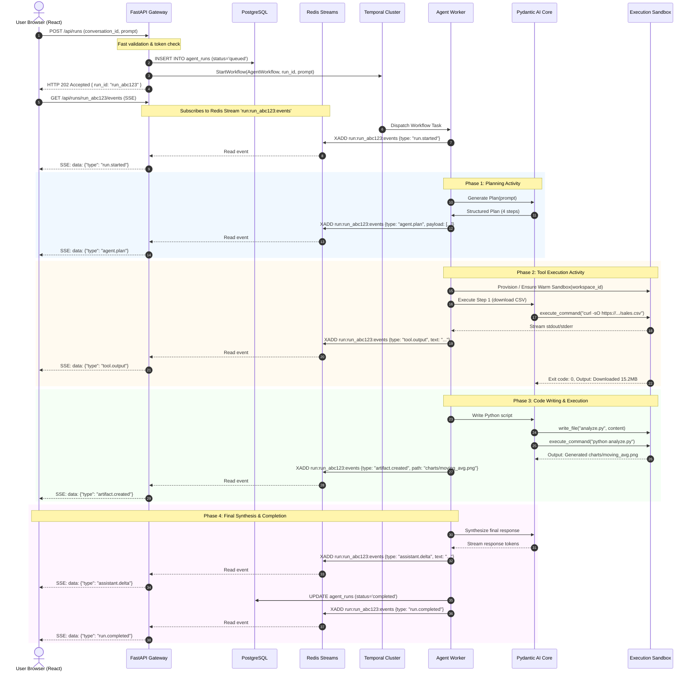

# Spark System Architecture: Master Technical Blueprint

## 1. Executive Summary & Platform Vision

**Spark** is an enterprise-grade, multi-tenant autonomous AI agent platform designed for complex software development, arbitrary code execution, and data workflows. Inspired by platforms such as Gemini Spark, Devin, and Manus, Spark provides users with an intelligent coding partner capable of:

- Translating high-level user instructions into comprehensive, multi-step engineering plans.
- Executing arbitrary shell commands, compiling code, running scripts (Python, Node.js, Bash, Rust, Go), and installing packages.
- Creating, reading, editing, and managing persistent project files within an isolated workspace.
- Operating reliably across runs that take anywhere from **5 seconds to several hours**.
- Streaming live thoughts, plans, file changes, and assistant responses to the user in real time.
- Allowing users to safely disconnect, close browser tabs, and reconnect hours later without interrupting execution or losing state.

To fulfill these requirements at cloud scale, Spark strictly avoids monolithic designs and adopts an architecture based on **five decoupled lifecycles**:

1. **Client UI Lifecycle:** Transient, event-driven observer and control panel.
2. **API Gateway Lifecycle:** Stateless, high-throughput, non-blocking HTTP/SSE router.
3. **Durable Orchestration Lifecycle:** Resilient, stateful workflow coordinator surviving server restarts.
4. **Agent Worker Lifecycle:** Compute workers running the agent's LLM reasoning and decision loop.
5. **Sandbox & Workspace Lifecycle:** Hardware-isolated, persistent environments running untrusted user code.

---

## 2. Selected Technology Stack & Architectural Justification

Following comprehensive architectural analysis (detailed in [gemini.chat.md](./gemini.chat.md) and [chatgpt.chat.md](./chatgpt.chat.md)), the following technology stack has been established:

```
┌─────────────────────────────────────────────────────────────────────────────────┐
│                                SPARK TECH STACK                                 │
├──────────────────────┬──────────────────────────────────────────────────────────┤
│ Durable Engine       │ Temporal (Python SDK)                                    │
│ API Gateway          │ FastAPI (Python 3.12+, Uvicorn, AsyncIO)                │
│ Frontend Client      │ Vite + React 19 + TypeScript + Tailwind CSS              │
│ Event Streaming      │ Redis Streams + Server-Sent Events (SSE)                 │
│ Agent Intelligence   │ Pydantic AI + Pydantic AI Harness                        │
│ Code Sandbox         │ E2B (Phase 1) / gVisor & Firecracker microVMs (Phase 2)  │
│ Database             │ PostgreSQL 16+ (SQLModel / SQLAlchemy Async)             │
│ Workspace Storage    │ Persistent Cloud Volumes (EFS/Ceph/CSI) + S3 Backups     │
│ Observability        │ OpenTelemetry + Logfire / Jaeger                         │
└──────────────────────┴──────────────────────────────────────────────────────────┘
```

### Architectural Rationale

1. **Why Temporal over Celery / BullMQ:**
   Traditional task queues (Celery, BullMQ, RQ) are designed for short, fire-and-forget background jobs. When an agent run lasts 45 minutes, invokes 30 tool calls, and crashes mid-execution, a traditional queue requires writing bespoke state machines, custom checkpointing, and brittle manual recovery logic. Temporal provides **durable execution**: its deterministic event log records every activity completion. If an Agent Worker process crashes or the node terminates, another worker picks up the execution and replays history to resume exactly where it stopped. Temporal also natively handles durable timers, activity retries with exponential backoff, heartbeats, and human-in-the-loop approvals (via Signals).

2. **Why FastAPI:**
   FastAPI provides asynchronous, non-blocking I/O ideal for high-concurrency API gateways. It natively integrates with Python's async ecosystem, supports Server-Sent Events via `EventSourceResponse`, enforces Pydantic validation on all requests and responses, and shares the same language runtime as Temporal workers and Pydantic AI.

3. **Why React (Vite) over Next.js:**
   Spark is an authenticated, dynamic desktop-style web application featuring multi-pane code editors (Monaco), structured task plan progress indicators, file trees, and real-time SSE streams. It does not require Server-Side Rendering (SSR) or search engine optimization (SEO). Using Next.js would introduce a redundant Node.js backend layer on top of the FastAPI backend. A pure Vite + React SPA keeps the architecture clean: FastAPI is the single authoritative backend.

4. **Why Redis Streams + SSE (and Completely Transparent Sandboxing):**
   - **Redis Streams vs. Pub/Sub:** Redis Pub/Sub is "fire-and-forget" with no memory. If a browser disconnects during a network hiccup, all events published during that window are permanently lost. Redis Streams provides an ordered, append-only event log with persistent stream IDs (`<timestamp>-<seq>`).
   - **SSE vs. WebSockets:** Server-Sent Events operates over standard HTTP, natively supports automatic browser reconnection, and works seamlessly with reverse proxies and corporate firewalls. Clients supply a `Last-Event-ID` header upon reconnecting to replay any missed events from the Redis Stream without custom sync protocols.
   - **Transparent Execution Model:** Sandboxes and shell execution are **entirely transparent to the user**. The user never interacts with a terminal or shell. There is no terminal component in the UI. All command executions are invoked autonomously by the Pydantic AI agent inside background sandboxes, and users track progress solely through high-level milestones and code artifacts.

5. **Why Pydantic AI:**
   Pydantic AI is built specifically for generative AI agent applications in Python, offering first-class Pydantic schema validation for tool parameters and structured LLM outputs. Combined with **Pydantic AI Harness**, it provides battle-tested primitives for coding agents: planning, filesystem operations, shell execution, subagent delegation, and context window compaction.

---

## 3. System Architecture Topology

The following diagram illustrates the complete architectural layout of Spark, showing network boundaries, data flows, and component responsibilities:

```mermaid
flowchart TB
    subgraph PublicClient["Client Tier (User Browser)"]
        Browser["React 19 SPA (Vite)"]
        ChatUI["Chat Timeline & Instructions"]
        Editor["Monaco Code Editor & Diff Viewer"]
        PlanTimeline["Task Plan & Milestone Roadmap"]
        FileExplorer["Workspace File Explorer"]
        SSEConsumer["SSE Consumer (EventSource)"]
    end

    subgraph IngressGateway["Ingress & API Gateway (FastAPI)"]
        Nginx["Reverse Proxy / SSL / Ingress"]
        FastAPI_App["FastAPI Server"]
        AuthMiddleware["JWT / Session Auth"]
        SSE_Service["SSE Streaming Service\n(EventSourceResponse)"]
        Policy["Strict Agent-Only Execution\n(Zero Direct User Shell Endpoints)"]
    end

    subgraph DurableCoordination["Coordination & Durable Storage Tier"]
        TemporalServer["Temporal Server Cluster\n(Frontend, History, Matching, DB)"]
        Postgres[("PostgreSQL 16+\n(Users, Workspaces, Runs, Metadata)")]
        RedisCore[("Redis Cluster\n(Streams, Locks, Cache)")]
    end

    subgraph AgentWorkerTier["Agent Execution Tier (Worker Nodes)"]
        TemporalWorker["Temporal Worker Process"]
        WorkflowDef["Agent Orchestration Workflow"]
        Activities["Temporal Activities"]
        PydanticAIEngine["Pydantic AI Agent Core"]
        Harness["Pydantic AI Harness\n(Coder, Planning, Memory, SubAgents)"]
        LLMProvider["LLM APIs (Anthropic Claude 3.5, OpenAI GPT-4o, Gemini 1.5 Pro)"]
    end

    subgraph SandboxTier["Isolated Execution Sandbox Tier"]
        SandboxController["Sandbox Manager (E2B / microVM Controller)"]
        
        subgraph TenantA["Tenant Workspace A Sandbox"]
            VM_A["MicroVM / gVisor Container A"]
            Shell_A["Shell (bash/zsh)"]
            PyEnv_A["Python / Node / Tools"]
            Mount_A["/workspace (Mounted Volume A)"]
        end

        subgraph TenantB["Tenant Workspace B Sandbox"]
            VM_B["MicroVM / gVisor Container B"]
            Mount_B["/workspace (Mounted Volume B)"]
        end
        
        StoragePool[("Persistent Storage Engine\n(NFS / Ceph / AWS EFS)")]
        ObjectStore[("Object Storage\n(AWS S3 / MinIO)")]
    end

    %% Client communication
    Browser -->|HTTPS REST| Nginx
    Browser -->|SSE Connection| Nginx
    Nginx --> FastAPI_App
    FastAPI_App --> AuthMiddleware
    AuthMiddleware --> SSE_Service
    AuthMiddleware --> Policy

    %% Gateway to Coordination
    FastAPI_App -->|Write Metadata / Run Records| Postgres
    FastAPI_App -->|Start Workflow Execution| TemporalServer
    SSE_Service -->|Read / Replay Stream via XREAD| RedisCore

    %% Durable Workflow Execution
    TemporalServer <-->|Poll Tasks / Dispatch| TemporalWorker
    TemporalWorker --> WorkflowDef
    WorkflowDef --> Activities
    Activities --> PydanticAIEngine
    PydanticAIEngine --> Harness
    Harness <-->|Prompts / Streaming Completions| LLMProvider
    
    %% Worker to Coordination & Sandboxes
    Activities -->|Publish Typed Events (XADD)| RedisCore
    Activities -->|Update Run Status / Results| Postgres
    Activities -->|RPC: Execute Command / Filesystem| SandboxController

    %% Sandbox Management
    SandboxController --> VM_A
    SandboxController --> VM_B
    Mount_A <--> StoragePool
    Mount_B <--> StoragePool
    SandboxController -->|Snapshots & Artifact Exports| ObjectStore
```

---

## 4. End-to-End Execution Flow

When a user submits a prompt (e.g., *"Download the sales CSV, clean it, write a Python script to compute moving averages, and generate charts"*), the execution moves across decoupled services through the sequence illustrated below:



---

## 5. The Three Tiers of State

A fundamental insight from the Spark architecture design is that **Agent Memory**, **Execution State**, and **Workspace Persistence** must never be conflated. They represent three distinct lifecycles and require different storage mechanisms:

```
┌─────────────────────────────────────────────────────────────────────────────┐
│                          SPARK STATE ARCHITECTURE                           │
├───────────────────────┬──────────────────────────┬──────────────────────────┤
│ State Category        │ Concrete Examples        │ Authoritative Store      │
├───────────────────────┼──────────────────────────┼──────────────────────────┤
│ 1. Conversation       │ User prompts, assistant  │ PostgreSQL               │
│    Memory             │ responses, summary notes │                          │
├───────────────────────┼──────────────────────────┼──────────────────────────┤
│ 2. Agent Execution    │ Current step, tool call  │ Temporal Workflow History│
│    State              │ history, retry count     │                          │
├───────────────────────┼──────────────────────────┼──────────────────────────┤
│ 3. Workspace State    │ Downloaded files, git    │ Persistent Volumes       │
│                       │ repos, installed packages│ (Block/NFS) + S3 Backups │
└───────────────────────┴──────────────────────────┴──────────────────────────┘
```

1. **Conversation Memory (PostgreSQL):**
   Stores messages, user profiles, conversation threads, and token compaction summaries. This state is queried by the API Gateway to display chat history when a user logs in.
2. **Agent Execution State (Temporal):**
   Stores the live execution state of an ongoing run. If a worker fails, Temporal replays this state to recreate local variables, tool invocation results, and decision points. Once a run finishes, this state becomes immutable history.
3. **Workspace State (Persistent Storage):**
   Stores the physical filesystem files created by or provided to the agent. This state lives independently of the sandbox container. When a sandbox is destroyed after 15 minutes of idle time, the workspace storage remains untouched, ready to be remounted to a new sandbox for the next execution.

---

## 6. Multi-User Concurrency & Workspace Isolation

Spark is built from the ground up as a multi-tenant platform. Multi-user execution is governed by two core rules:

### A. Tenant Isolation Across Users
- Every user belongs to their own isolated security boundary.
- User A's agent runs in **Sandbox A** with **Workspace Storage A**.
- User B's agent runs in **Sandbox B** with **Workspace Storage B**.
- Sandboxes run inside distinct microVMs/namespaces with no shared network interfaces, strictly prohibited from discovering or contacting each other.

### B. Concurrency Control Within the Same Workspace
What happens if User A starts two runs simultaneously in the same workspace (or the agent triggers parallel tasks)?

```
Workspace A
    │
    ▼
[Redis Distributed Lock with Fencing Token]
    │
    ├── Job 1 (Active: Holds Fencing Token #101) ──► Allowed to write to /workspace
    └── Job 2 (Waiting in Queue)                  ──► Blocked until Job 1 releases lock
```

- **Approach A (Baseline / Phase 1): Workspace-Level Mutex Lock.**
  A distributed lock with renewal heartbeats and a monotonically increasing **fencing token** (stored in Redis or PostgreSQL) ensures that only one write execution modifies a workspace at any time. If Run 2 is requested while Run 1 is active, Run 2 is queued.
- **Approach B (Advanced / Phase 3): Copy-on-Write Workspace Branches.**
  For true parallel multi-agent development within one workspace, the system creates copy-on-write volume snapshots or Git worktrees. Agents work in isolated branches and merge changes back to the main workspace upon completion.

---

## 7. Transparent Execution Architecture & Zero-Terminal UI

A foundational design tenet of Spark is that **code execution and shell environments are completely transparent to the user**. The user never sees a terminal window, CLI prompt, or raw command stream, and cannot interact with execution environments in any way.

### Architectural Rules & Safeguards:
1. **Zero Terminal in the UI:** Spark completely omits terminal emulators (`xterm.js`). There is no terminal tab, panel, or CLI widget in the user interface.
2. **Transparent Code Execution:** When the agent runs shell scripts, installs packages, compiles code, or executes Python scripts, it does so autonomously inside the backend isolated sandbox. The user is entirely shielded from low-level terminal mechanics, escape codes, and noisy command logs.
3. **High-Level Milestone Progress:** Progress is communicated through structured, human-friendly milestones (`agent.plan` and `agent.status`) in the UI, such as *"Analyzing CSV structure"*, *"Writing calculation script"*, and *"Generating visual charts"*.
4. **Agent-Mediated Sandbox Access Only:** Sandboxes accept execution requests exclusively from internal Temporal activity workers running Pydantic AI. No direct execution endpoints exist for users.
5. **Declarative User Interaction:** The user's role is strictly declarative:
   - Requesting goals and tasks through natural language prompts.
   - Reviewing created files, diffs, and artifacts in the Monaco code editor.
   - Granting or denying binary approvals (`POST /api/runs/{id}/input`) for sensitive actions proposed by the agent.

---

## 8. Disconnection Resilience: The Offline-First Model

A primary user requirement is that browser tabs are completely decoupled from agent runs:

1. **Fire-and-Observe:** The browser sends `POST /api/runs`, gets a `run_id`, and opens an SSE stream.
2. **Client Disconnection:** If the user closes the laptop lid or suffers network loss, the FastAPI SSE connection closes cleanly. The Temporal workflow and Agent Worker continue running completely unaware of the browser's absence.
3. **Event Buffering:** All emitted events are appended to the Redis Stream `run:<run_id>:events` with retention policies (e.g., 24 hours).
4. **Client Reconnection:** When the user reopens the app:
   - The React frontend makes a fast REST call `GET /api/runs/{run_id}` to check current status.
   - The frontend establishes an SSE stream passing the HTTP header:
     `Last-Event-ID: 1731751200000-0`
   - FastAPI issues an `XREAD` query against Redis Streams starting strictly *after* that event ID, immediately replaying all missed events to the frontend before seamlessly transitioning to live events.

---

## 9. Summary of Architectural Subsystems

Detailed specifications for each component are located in the referenced documents:

- **[Temporal Workflow Architecture](./TEMPORAL_WORKFLOWS.md):** Deep-dive on workflow definitions, activity timeouts, idempotency keys, and human-in-the-loop approvals.
- **[Pydantic AI Agent Architecture](./AGENT_PYDANTIC_AI.md):** System prompt structures, type-safe tools, Pydantic AI Harness integration, and context compaction.
- **[Redis Streams & SSE Streaming Protocol](./EVENT_STREAMING.md):** Stream key topology, consumer logic, typed event schemas, and reconnect protocols.
- **[Sandbox Isolation & Security](./SANDBOX_AND_SECURITY.md):** E2B, gVisor, Firecracker comparisons, network egress filtering, transparent execution boundary, and persistent volume management.
- **[API Contracts & Database Schemas](./API_AND_DATABASE.md):** Complete PostgreSQL relational schema, FastAPI routes, and Pydantic DTO models.
- **[Frontend Architecture](./FRONTEND_DESIGN.md):** React 19 component hierarchy, custom SSE stream hooks, Monaco code editor, task plan milestones, and transparent terminal-free workspace.
