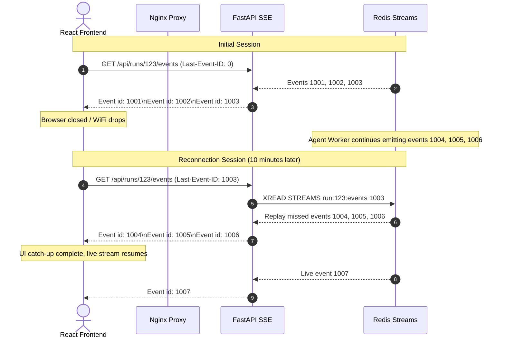

# Real-Time Event Streaming: Redis Streams & SSE Protocol

## 1. Overview & Architectural Motivation

In the Spark architecture, the user's browser observes high-level agent progress: structured task plans, file modifications, status transitions, and streaming responses.

However, the agent's execution is **completely decoupled** from the browser's HTTP connection:
- A run may last 2 hours.
- A user may close the laptop, switch networks, or experience intermittent disconnects.
- The worker running the agent has zero knowledge of whether the user is currently online.

To satisfy these requirements, Spark implements a **two-stage event streaming pipeline**:

```
┌─────────────────┐       Stream 1 (Internal)      ┌───────────────────┐       Stream 2 (HTTP)      ┌─────────────────┐
│  Agent Worker   │ ─────────────────────────────► │   Redis Streams   │ ─────────────────────────► │  React Browser  │
│ (Pydantic / Temp│       XADD run:123:events      │ (Append-Only Log) │        FastAPI SSE         │ (EventSource)   │
└─────────────────┘                                └───────────────────┘    Last-Event-ID Replay    └─────────────────┘
```

---

## 2. Why Redis Streams (Not Redis Pub/Sub)

A frequent architectural anti-pattern is using Redis Pub/Sub for agent streaming. The table below illustrates why Redis Streams was selected:

| Architectural Metric | Redis Pub/Sub | Redis Streams |
| :--- | :--- | :--- |
| **Persistence** | None (Transient). Lost if no subscriber is active. | Persistent append-only log with configurable TTL / maxlen. |
| **Disconnection Tolerance** | Zero. Events emitted while browser is offline are gone forever. | **Total.** Missed events can be replayed from the exact disconnect timestamp. |
| **Message Ordering** | Best-effort, unindexed. | Strict chronological IDs (`<unix_ms>-<sequence>`). |
| **Consumer Tracking** | No state tracking. | Consumer groups, read offsets, and pending lists. |
| **Reconnection Complexity**| High (requires querying PostgreSQL for missed history). | Low (native `XREAD` using client's `Last-Event-ID`). |

---

## 3. Redis Stream Key Topology & Operations

### Stream Naming Convention
For every agent run, a dedicated Redis Stream is created:
```
run:<run_id>:events
```
Example: `run:run_9f4c3a1e:events`

### Stream Retention Policy
To prevent memory leaks while preserving execution records, events are stored with an approximate size cap (`MAXLEN ~ 5000`) and a TTL:
```bash
# Add event to stream with auto-trimming
XADD run:run_9f4c3a1e:events MAXLEN ~ 5000 * type "assistant.delta" data '{"text": "Hello"}'

# Set 24-hour expiration on the stream key
EXPIRE run:run_9f4c3a1e:events 86400
```

---

## 4. Canonical Event Schema

Every event published to Redis and transmitted over SSE follows a standard JSON envelope:

```typescript
export interface SparkEvent<T = any> {
  id: string;          // Redis Stream ID, e.g. "1731751200000-0"
  run_id: string;      // Unique agent run identifier
  type: SparkEventType;// Strongly typed event discriminator
  timestamp: string;   // ISO-8601 UTC timestamp
  payload: T;          // Strongly typed event payload
}
```

### Event Catalog

| Event Type | Description | Payload Schema |
| :--- | :--- | :--- |
| `run.queued` | Run submitted to system, pending worker. | `{ position: number }` |
| `run.started` | Worker picked up workflow and started. | `{ started_at: string, worker_id: string }` |
| `agent.status` | High-level status update for UI banners. | `{ status: string, message: string }` |
| `agent.plan` | Generated task plan and milestones. | `{ steps: Array<{ id: int, title: str, status: str }> }` |
| `assistant.delta` | Incremental LLM markdown token chunks. | `{ text: string }` |
| `tool.started` | A tool has started executing. | `{ tool: string, params: object }` |
| `tool.output` | Internal command stdout/stderr chunks (telemetry/audit). | `{ stream: "stdout" \| "stderr", text: string }` |
| `tool.completed` | Tool execution finished. | `{ tool: string, exit_code: number, duration_ms: number }` |
| `artifact.created` | New file generated in `/workspace`. | `{ path: string, size_bytes: number }` |
| `artifact.modified`| Existing file modified via diff/edit. | `{ path: string, replacements: number }` |
| `approval.required`| Paused waiting for user consent. | `{ step_id: number, command: string, reason: string }` |
| `run.completed` | Run finished successfully. | `{ summary: string, total_duration_seconds: number }` |
| `run.failed` | Run terminated with unrecoverable error. | `{ error: string, traceback?: string }` |

---

## 5. FastAPI SSE Implementation

FastAPI handles the SSE connection, consumes from Redis Streams using `XREAD`, and streams chunks to the client using `EventSourceResponse` (`sse-starlette`):

```python
"""
spark/api/routes/events.py
FastAPI Server-Sent Events (SSE) router reading from Redis Streams.
"""

import json
from typing import AsyncGenerator
from fastapi import APIRouter, Request, HTTPException, Header
from sse_starlette.sse import EventSourceResponse, ServerSentEvent
import redis.asyncio as aioredis
from spark.core.config import settings

router = APIRouter(prefix="/api/runs", tags=["Events"])


@router.get("/{run_id}/events")
async def stream_run_events(
    run_id: str,
    request: Request,
    last_event_id: str = Header(default="0", alias="Last-Event-ID"),
) -> EventSourceResponse:
    """
    Server-Sent Events endpoint streaming real-time agent execution events.
    Supports reconnection and automatic event replay via 'Last-Event-ID'.
    """
    redis_client = aioredis.from_url(settings.REDIS_URL, decode_responses=True)
    stream_key = f"run:{run_id}:events"

    # Verify run exists
    stream_exists = await redis_client.exists(stream_key)
    if not stream_exists:
        # Check database if run is older or archived
        raise HTTPException(status_code=404, detail="Run not found or event stream expired.")

    async def event_generator() -> AsyncGenerator[ServerSentEvent, None]:
        current_last_id = last_event_id if last_event_id else "0"

        try:
            while True:
                # Disconnect check
                if await request.is_disconnected():
                    break

                # XREAD blocks up to 5000ms waiting for new messages
                response = await redis_client.xread(
                    streams={stream_key: current_last_id},
                    count=100,
                    block=5000,
                )

                if not response:
                    # Send periodic SSE keepalive comment to avoid proxy timeouts
                    yield ServerSentEvent(comment="keepalive")
                    continue

                for _, messages in response:
                    for msg_id, data in messages:
                        current_last_id = msg_id
                        event_type = data.get("type", "message")
                        payload_raw = data.get("payload", "{}")

                        event_data = {
                            "id": msg_id,
                            "run_id": run_id,
                            "type": event_type,
                            "payload": json.loads(payload_raw),
                        }

                        yield ServerSentEvent(
                            id=msg_id,
                            event=event_type,
                            data=json.dumps(event_data),
                        )

                        # Terminate stream on completion or failure
                        if event_type in ("run.completed", "run.failed"):
                            return

        finally:
            await redis_client.close()

    return EventSourceResponse(
        event_generator(),
        headers={
            "Cache-Control": "no-cache",
            "X-Accel-Buffering": "no",  # Disables Nginx buffering for instant delivery
        },
    )
```

---

## 6. Disconnection & Replay Protocol



1. **Client Stores Last ID:** The browser tracks the `id` of each received SSE frame.
2. **Standard Header:** Upon reconnection, `EventSource` automatically sends `Last-Event-ID: <id>` in the request header.
3. **No Duplicate Processing:** `XREAD` only returns messages with IDs strictly greater than `<id>`.
4. **Seamless Resume:** Missed milestones, logs, and token chunks are flushed immediately to the frontend.

---

## 7. Transparent Sandboxing: Zero Terminal Exposure

A defining architectural principle of Spark is that **code execution and shell mechanics are completely transparent to the user**. The user interface contains no terminal emulator, prompt, or raw command console.

- **Zero Terminal in UI:** Users never see or interact with a terminal. All shell operations (running scripts, installing packages, compilation) occur autonomously inside the isolated backend sandbox.
- **High-Level UI Streaming:** The user interface focuses entirely on high-level deliverables:
  - Structured task plan milestones (`agent.plan`) with progress spinners and checkmarks.
  - Informative status notifications (`agent.status`).
  - Generated files, diffs, and code artifacts rendered in the Monaco editor (`artifact.created` / `artifact.modified`).
  - Streaming conversational explanations and answers (`assistant.delta`).
- **Telemetry & Audit Logging:** While `tool.output` events are captured in Redis Streams and persisted in PostgreSQL (`tool_executions`) for system auditing, debugging, and agent error correction, they are deliberately decoupled from user rendering. The user simply asks the agent to perform tasks and receives the completed results.
