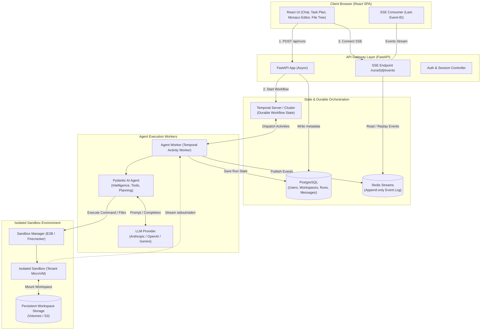

# Spark Project Documentation

Welcome to the **Spark** architectural documentation suite. Spark is a multi-tenant, cloud-based autonomous AI agent platform inspired by Gemini Spark, Devin, and Manus. It empowers users to delegate complex, multi-step tasks to an AI agent capable of arbitrary code execution, shell commands, file manipulation, package installations, and iterative software development within secure, persistent workspaces.

---

## 🚀 Core Technology Stack

| Layer | Technology | Purpose & Architectural Role |
| :--- | :--- | :--- |
| **Durable Orchestration** | [Temporal](https://temporal.io) | Long-running workflow reliability, deterministic state machine, activity retries, crash recovery, durable timers, and human-in-the-loop approvals. |
| **Backend & API Gateway** | [FastAPI](https://fastapi.tiangolo.com) | Non-blocking async Python API server, user authentication, session/workspace management, SSE streaming endpoints, and job initiation. |
| **Frontend UI** | [Vite + React + TS](https://vitejs.dev) | High-performance interactive single-page application (SPA), conversational interface, task plan milestones tracker, Monaco code editor, file tree explorer, and resilient event stream consumer. |
| **Event Streaming** | [Redis Streams](https://redis.io/docs/latest/develop/use-cases/streaming/) + [SSE](https://developer.mozilla.org/en-US/docs/Web/API/Server-sent_events) | Decoupled event pub/sub with append-only buffer storage. Powers Server-Sent Events (SSE) to the browser with automatic reconnect and event replay via `Last-Event-ID`. |
| **Agent Intelligence** | [Pydantic AI](https://ai.pydantic.dev) | Type-safe agent logic, Pydantic validation, tool definitions (filesystem, shell, web), planning harness, subagent delegation, and context compaction. |
| **Execution Sandboxes** | [E2B](https://e2b.dev) / gVisor / Firecracker | Multi-tenant isolated microVM/container runtimes for arbitrary code and shell execution with strict CPU, RAM, and network boundaries. |
| **Persistent Storage** | PostgreSQL + Persistent Volumes + S3 | PostgreSQL for relational metadata, local/network block volumes for persistent workspaces, and S3 for artifacts and snapshots. |

---

## 📚 Documentation Index

The documentation is organized into modular, deep-dive specifications covering every facet of the platform:

```
docs/
├── README.md                      # Documentation Hub & Executive Overview (this file)
├── ARCHITECTURE.md                # Master Architecture & System Design Blueprint
├── TEMPORAL_WORKFLOWS.md          # Temporal Orchestration, Workflows, Activities & Resilience
├── AGENT_PYDANTIC_AI.md           # Pydantic AI Agent, Harness, Tooling & Context Management
├── EVENT_STREAMING.md             # Redis Streams + SSE Streaming Protocol & Event Schemas
├── SANDBOX_AND_SECURITY.md        # Sandbox Isolation (E2B/Firecracker), Volumes & Concurrency
├── API_AND_DATABASE.md            # FastAPI REST & SSE Contracts, Database Schemas (PostgreSQL)
├── FRONTEND_DESIGN.md             # React + Vite Frontend Architecture, UI Components & State
├── chatgpt.chat.md                # Raw architectural chat transcript (ChatGPT)
└── gemini.chat.md                 # Raw architectural chat transcript (Gemini)
```

### Document Summaries

1. **[Master Architecture & System Design (`ARCHITECTURE.md`)](./ARCHITECTURE.md)**
   - High-level system topology and separation of concerns.
   - Decoupled lifecycles: Frontend, API Gateway, Agent Worker, Sandbox, and Storage.
   - End-to-end request lifecycle and sequence diagrams.
   - Core design principles, trade-offs, and scaling strategy.

2. **[Temporal Workflow Engine (`TEMPORAL_WORKFLOWS.md`)](./TEMPORAL_WORKFLOWS.md)**
   - Why Temporal was chosen over traditional message queues (Celery/BullMQ).
   - Workflow state machine: Queued $\rightarrow$ Initializing $\rightarrow$ Planning $\rightarrow$ Executing $\rightarrow$ Waiting $\rightarrow$ Synthesizing $\rightarrow$ Completed.
   - Activity design: LLM calls, sandbox execution, event publishing, and idempotency keys.
   - Crash recovery, activity timeouts, heartbeats, and human-in-the-loop pauses.

3. **[Pydantic AI Agent Architecture (`AGENT_PYDANTIC_AI.md`)](./AGENT_PYDANTIC_AI.md)**
   - Type-safe agent core, system prompts, and dependency injection (`RunContext`).
   - Tool calling layer: `execute_command`, `read_file`, `write_file`, `edit_file`, `list_files`, `grep`.
   - Pydantic AI Harness integration: Planning, Coder harness, Subagents, and Context Compaction.
   - Separation of agent memory, execution state, and workspace files.

4. **[Event Streaming with Redis & SSE (`EVENT_STREAMING.md`)](./EVENT_STREAMING.md)**
   - Why Redis Streams is used instead of transient Redis Pub/Sub.
   - Stream key architecture and consumer patterns.
   - FastAPI Server-Sent Events implementation with `EventSourceResponse`.
   - Complete event schema specifications (`agent.status`, `agent.plan`, `assistant.delta`, `tool.output`, etc.).
   - Disconnection handling, offline tolerance, and event replay via `Last-Event-ID`.

5. **[Execution Sandboxes & Security Architecture (`SANDBOX_AND_SECURITY.md`)](./SANDBOX_AND_SECURITY.md)**
   - Sandbox runtime comparison: Docker vs. gVisor vs. Firecracker vs. E2B.
   - Persistent workspaces vs. ephemeral execution runtimes.
   - Sandbox lifecycle: Provisioning, warm pools, idle suspension, and snapshotting.
   - Multi-tenant isolation: strict cgroups, memory/CPU quotas, PID limits, read-only root, no host Docker socket.
   - Network egress security: transparent proxies, internal network blocking, domain whitelisting.
   - Workspace concurrency control: Distributed locking with fencing tokens vs. copy-on-write branching.

6. **[API Specifications & Database Models (`API_AND_DATABASE.md`)](./API_AND_DATABASE.md)**
   - PostgreSQL relational schema DDL: `users`, `workspaces`, `conversations`, `messages`, `agent_runs`, `tool_executions`, `artifacts`.
   - FastAPI REST API endpoints: run creation, cancellation, status polling, user inputs, artifact downloads.
   - SSE endpoint contract and event streaming specification (with zero direct user execution endpoints).
   - Pydantic models for request validation and response serialization.

7. **[Frontend Architecture & UI Design (`FRONTEND_DESIGN.md`)](./FRONTEND_DESIGN.md)**
   - React 19 + Vite + TypeScript setup and directory structure.
   - Custom `useAgentStream` hook for robust SSE connection, buffer processing, and auto-reconnect.
   - Component hierarchy: Conversational Timeline, Task Plan / Milestones Tracker, Monaco Code Editor, File Tree Explorer (completely terminal-free UI).
   - State management strategy (Zustand / React Context) for multi-tab workspace operations.

---

## 🏛️ High-Level System Architecture Diagram



---

## 🛠️ Incremental Development Roadmap

1. **Phase 1: Agent Core & Managed Sandbox (MVP)**
   - Implement FastAPI backend with async endpoints and PostgreSQL models.
   - Build Pydantic AI agent with shell and filesystem tools running inside an **E2B** sandbox.
   - Configure Redis Streams and FastAPI SSE endpoint to stream live agent events (`assistant.delta`, `agent.status`, `tool.output`).
   - Implement React frontend chat interface with SSE subscription.

2. **Phase 2: Durable Execution & Workspace Persistence**
   - Integrate **Temporal** for long-running workflow orchestration.
   - Wrap Pydantic AI agent steps in Temporal activities with automatic retry policies and heartbeats.
   - Implement persistent workspace volume attachments so downloaded packages and files survive sandbox restarts.
   - Implement workspace concurrency locks in Redis with fencing tokens.

3. **Phase 3: Human-in-the-Loop & Advanced Frontend**
   - Implement interactive approvals (e.g., agent pauses for user confirmation before executing critical operations).
   - Integrate **Monaco Editor** for side-by-side file viewing and diffing.
   - Transparent execution pipeline: agent manages shell tools silently in background sandboxes while surfacing structured milestone progress to the UI.
   - Support browser disconnection tolerance and seamless event replay using `Last-Event-ID`.

4. **Phase 4: Self-Hosted Production Infrastructure**
   - Transition or supplement E2B with self-hosted **gVisor** or **Firecracker** microVM clusters for cost reduction at scale.
   - Deploy network egress filtering proxy with domain allowlisting and private subnet blacklisting.
   - Implement automated workspace snapshots to S3 / Cloud Object Storage.
