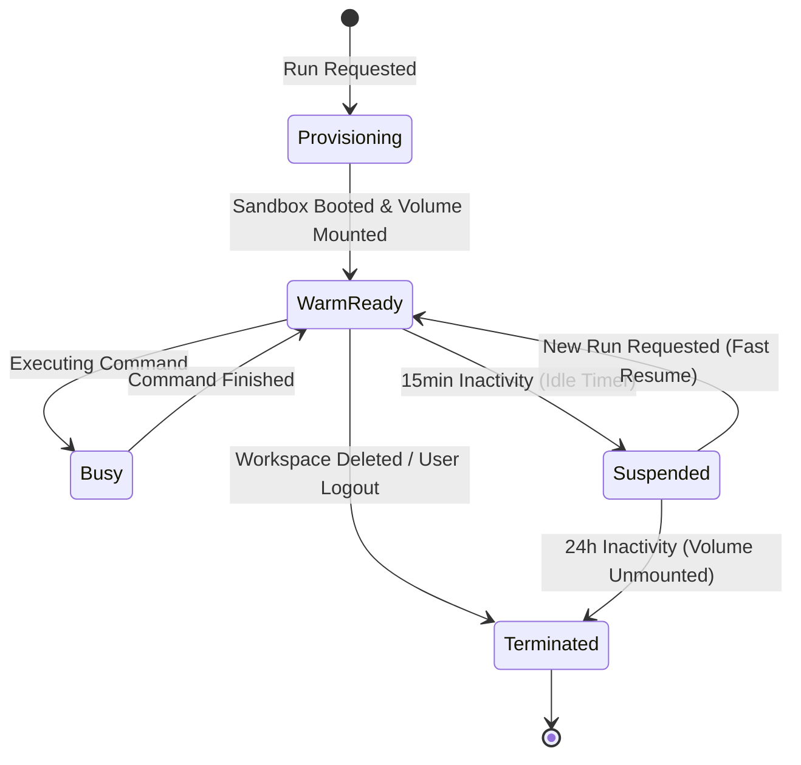

# Execution Sandboxes & Security Architecture

## 1. Overview & Threat Model

The core value proposition of Spark is the ability to execute **arbitrary code and shell scripts** on behalf of the user. However, running untrusted code on a multi-tenant platform introduces severe security risks:

### Identified Threat Vectors
1. **Host Kernel Breakout:** Exploits attempting to escape container boundaries and compromise the physical host.
2. **Cross-Tenant Data Tampering:** Malicious processes reading or modifying other users' persistent workspace files.
3. **Internal Network Probing (SSRF):** Code scanning internal VPC networks to access backend databases, Redis clusters, Kubernetes control planes, or cloud metadata endpoints (`169.254.169.254`).
4. **Denial of Service (DoS):** Fork bombs (`:(){ :|:& };:`), infinite CPU loops, memory bloat (OOM crashes), or disk exhaustion attacks.
5. **Credential Theft:** Unauthorized attempts to inspect environment variables, secrets, or host credentials.

To mitigate these risks, Spark enforces **defense-in-depth** across hardware, network, and application layers.

---

## 2. Sandbox Technology Options & Evaluation

The platform evaluates four sandbox technologies across its developmental phases:

```
┌──────────────────────────────────────────────────────────────────────────────────┐
│                           SANDBOX TECHNOLOGY MATRIX                              │
├────────────────────┬──────────────┬──────────────┬──────────────┬────────────────┤
│ Metric             │ Docker       │ gVisor       │ Firecracker  │ E2B            │
│                    │ (Standard)   │ (runsc)      │ MicroVMs     │ (Managed)      │
├────────────────────┼──────────────┼──────────────┼──────────────┼────────────────┤
│ Isolation Level    │ Kernel Namespaces│ Syscall Interception│ Hardware KVM│ Hardware KVM │
│ Boot Latency       │ ~500ms       │ ~800ms       │ ~150ms       │ ~200ms         │
│ Threat Resilience  │ ⚠️ Low (Shared)│ ✅ High     │ 🛡️ Maximum    │ 🛡️ Maximum     │
│ Host Syscall Access│ Direct       │ Virtualized  │ Isolated Guest│ Isolated Guest│
│ Operational Effort │ Low          │ Medium       │ High         │ Zero (Managed) │
│ Phase Recommendation│ Local Dev   │ Self-Hosted  │ Scale Prod   │ MVP / Phase 1  │
└────────────────────┴──────────────┴──────────────┴──────────────┴────────────────┘
```

### Strategic Recommendation:
- **Phase 1 (MVP):** Use **E2B**. E2B provides pre-built, hardware-isolated microVM sandboxes out of the box with native Python/Node.js SDKs, sub-second spinup, and persistent filesystem hooks.
- **Phase 2 (Self-Hosted Scale):** Deploy **Firecracker microVMs** on bare-metal cloud instances (e.g. AWS `c5.metal` or Hetzner) or **gVisor** on Kubernetes to eliminate per-minute third-party SaaS costs.

---

## 3. Persistent Workspace vs. Ephemeral Sandbox

A fundamental architectural principle of Spark is: **The execution container is not the permanent storage.**

```
┌────────────────────────────────────────────────────────┐
│               SANDBOX & WORKSPACE TOPOLOGY             │
├────────────────────────────────────────────────────────┤
│                                                        │
│   [Isolated Sandbox Instance]                          │
│   ┌───────────────────────────────────────────────┐    │
│   │ Ephemeral Root Filesystem (/)                │    │
│   │ Installed OS Packages (apt, curl, git)        │    │
│   │ Process Table (PID Namespace)                 │    │
│   │                                               │    │
│   │   /workspace (Mount Point)                    │    │
│   └───────▲───────────────────────────────────────┘    │
│           │ Mounted Volume                             │
│   ┌───────┴───────────────────────────────────────┐    │
│   │ [Persistent Workspace Storage]                │    │
│   │  • Git Repositories                           │    │
│   │  • Downloaded Datasets                        │    │
│   │  • Virtual Environments (.venv)               │    │
│   │  • User Source Code Files                     │    │
│   └───────────────────────────────────────────────┘    │
│                                                        │
└────────────────────────────────────────────────────────┘
```

### Decoupled Lifecycle Benefits
1. **Resilience:** If untrusted code causes a kernel panic, memory exhaustion, or freezes the sandbox, the sandbox process can be instantly killed and replaced without losing any user files.
2. **Cost Efficiency:** Sandboxes are automatically suspended or terminated after 15 minutes of inactivity. When the user returns hours later, a new sandbox is provisioned and the persistent volume is re-attached in milliseconds.
3. **Snapshotting:** Workspace storage can be backed up to S3 asynchronously without stopping active computations.

---

## 4. Sandbox Lifecycle State Machine



### Lifecycle States
1. **Provisioning:** The Sandbox Manager allocates a microVM and mounts the tenant's persistent volume to `/workspace`.
2. **WarmReady:** Sandbox is hot in memory, listening for tool commands via gRPC/HTTP.
3. **Busy:** Actively executing Python scripts, shell commands, or compilation tasks.
4. **Suspended:** Memory state paused or container stopped; persistent volume detached and preserved.
5. **Terminated:** MicroVM destroyed. Workspace volume remains in persistent storage (Ceph/EFS/S3).

---

## 5. Security Controls & Guardrails

To prevent malicious abuse, every sandbox instance is locked down with strict security constraints:

### 1. Resource Limits (cgroups v2)
- **CPU Quota:** Hard cap at 2.0 vCPUs per sandbox.
- **Memory Limit:** Hard cap at 4GB RAM + 512MB Swap. Out-of-Memory killer kills the offending sub-process, not the host.
- **PID Limit:** `pids.max = 256` to render fork bombs completely harmless.
- **Disk Quota:** Max 10GB per `/workspace` volume.

### 2. Execution Timeouts
- All shell commands have a default execution timeout of **120 seconds**.
- Long-running commands (e.g. model training, builds) require explicit opt-in with activity heartbeats up to a maximum hard ceiling of 30 minutes.

### 3. Network Egress Filtering & Proxy
Sandboxes are isolated inside private network namespaces. All outbound traffic routes through a secure transparent egress proxy:

```
Sandbox Container ──► [Egress Filtering Proxy] ──► Internet (Pip, Npm, GitHub)
                              │
                              ├──► 🛑 Blocked: 10.0.0.0/8 (Internal VPC)
                              ├──► 🛑 Blocked: 172.16.0.0/12 (Internal VPC)
                              ├──► 🛑 Blocked: 192.168.0.0/16 (Internal VPC)
                              └──► 🛑 Blocked: 169.254.169.254 (Cloud Metadata)
```

- **Strict Internal Deny:** Sandboxes cannot communicate with internal PostgreSQL databases, Redis nodes, Temporal clusters, or cloud instance metadata.
- **Domain Whitelisting/Rate Limiting:** Protects against botnet participation and crypto-mining pool connections.

### 4. Privilege Restrictions
- **No Root Privilege:** Default execution user is a non-root user (`sparkuser` UID 1000).
- **No Docker Socket:** The host Docker socket (`/var/run/docker.sock`) is **never** mounted inside a sandbox.
- **Zero Host Secrets:** Database credentials, API tokens, and cloud keys are never placed in sandbox environment variables.

### 5. Transparent Execution & Agent-Only Boundary (Zero Terminal UI)
- **Zero Terminal in UI:** Users do not see, interact with, or type into any terminal emulator. The UI is completely terminal-free.
- **Zero Direct User Shell Access:** Users have no provision or endpoints to execute arbitrary commands directly.
- **Transparent Background Execution:** All shell commands, scripts, and builds run autonomously within the isolated sandbox, managed solely by the Pydantic AI agent via Temporal activities.
- **Declarative User Interaction:** Users interact exclusively by asking the agent to accomplish tasks in natural language, tracking milestone progress, and reviewing the created files in the code editor.

---

## 6. Workspace Concurrency Control

When multiple runs target the same workspace, race conditions can corrupt code or produce conflicting edits.

### Approach A: Workspace Distributed Lock with Fencing Tokens (Production Baseline)
Spark implements distributed mutual exclusion per workspace using Redis:

```python
"""
spark/services/workspace_lock.py
Distributed workspace lock with automatic renewal and fencing token.
"""

import time
import uuid
from typing import Optional
import redis.asyncio as aioredis


class WorkspaceLock:
    def __init__(self, redis_client: aioredis.Redis, workspace_id: str, ttl_seconds: int = 60):
        self.redis = redis_client
        self.workspace_id = workspace_id
        self.ttl = ttl_seconds
        self.lock_key = f"lock:workspace:{workspace_id}"
        self.fencing_key = f"fencing:workspace:{workspace_id}"
        self.token = str(uuid.uuid4())
        self.fencing_token: Optional[int] = None

    async def acquire(self) -> bool:
        """Acquires exclusive lock and increments monotonic fencing token."""
        acquired = await self.redis.set(self.lock_key, self.token, nx=True, ex=self.ttl)
        if acquired:
            self.fencing_token = await self.redis.incr(self.fencing_key)
            return True
        return False

    async def renew(self) -> bool:
        """Extends lock TTL during active execution."""
        script = """
        if redis.call('get', KEYS[1]) == ARGV[1] then
            return redis.call('expire', KEYS[1], ARGV[2])
        else
            return 0
        end
        """
        result = await self.redis.eval(script, 1, self.lock_key, self.token, self.ttl)
        return result == 1

    async def release(self) -> None:
        """Safely releases the lock if the token matches."""
        script = """
        if redis.call('get', KEYS[1]) == ARGV[1] then
            return redis.call('del', KEYS[1])
        else
            return 0
        end
        """
        await self.redis.eval(script, 1, self.lock_key, self.token)
```

- If an agent run is already executing in Workspace A, subsequent runs are queued until the lock is released.
- The monotonically increasing **fencing token** guarantees that an expired or zombie worker cannot write to storage if another worker has taken over.
