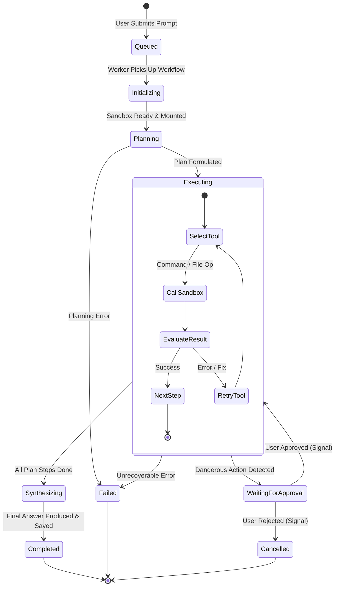

# Temporal Workflow Engine Specification

## 1. Role of Temporal in Spark

**Temporal** serves as the durable execution backbone of the Spark platform. In autonomous AI agent systems, tasks frequently execute for anywhere from 10 seconds to several hours. During such long execution windows, servers can crash, network connections can drop, container pods can be rescheduled by Kubernetes, or external LLM APIs can rate-limit requests.

Traditional task runners (such as Celery or BullMQ) treat tasks as monolithic background jobs. If a worker terminates halfway through an execution, the job either fails completely or must be retried from the beginning—potentially re-running destructive shell commands, wasting expensive LLM tokens, and corrupting files.

**Temporal solves this by providing durable state machines through event sourcing:**
- Every step completed in a workflow is recorded in Temporal's immutable event history.
- If a worker dies, another worker transparently reconstructs the execution state by replaying workflow history and resumes execution exactly where the failure occurred.
- Workflows can sleep for hours or wait for human input without consuming CPU or memory.
- Activities feature fine-grained retry policies, timeouts, and execution heartbeats.

---

## 2. Core Separation: Workflows vs. Activities

Temporal enforces a strict boundary between **deterministic workflow code** and **non-deterministic activity code**:

```
┌────────────────────────────────────────────────────────────────────────┐
│                        TEMPORAL WORKFLOW ENGINE                        │
├───────────────────────────────────┬────────────────────────────────────┤
│ WORKFLOW (Deterministic)          │ ACTIVITIES (Non-Deterministic)     │
├───────────────────────────────────┼────────────────────────────────────┤
│ • Coordinates execution sequence  │ • Calls LLM APIs (Pydantic AI)     │
│ • Maintains high-level state      │ • Dispatches commands to Sandbox   │
│ • Handles signals & human approval│ • Reads / Writes workspace files   │
│ • Manages durable timers          │ • Publishes events to Redis Streams│
│ • Cannot make network/I/O calls   │ • Updates PostgreSQL run status    │
└───────────────────────────────────┴────────────────────────────────────┘
```

---

## 3. Workflow Lifecycle State Machine

An agent run progresses through a well-defined state machine:



### Lifecycle States

| State | Description | Transition Triggers |
| :--- | :--- | :--- |
| `queued` | Run recorded in PostgreSQL, awaiting worker pickup. | Worker polls task queue. |
| `initializing` | Workspace volume mounted, sandbox checked/provisioned. | Sandbox manager confirms ready. |
| `planning` | Pydantic AI generates initial structured task plan. | Plan generated and validated. |
| `executing` | Agent iteratively calls LLM, executes tools in sandbox. | Looping through tool calls. |
| `waiting_for_approval` | High-risk action (e.g. `rm -rf`, git push) requires user confirmation. | Temporal signal received from user. |
| `synthesizing` | Agent reviews workspace artifacts and writes final response. | Summary tokens streamed. |
| `completed` | All artifacts stored, run marked successful. | Final state. |
| `failed` | Activity exceeded retry limits or fatal exception occurred. | Final state. |
| `cancelled` | User issued explicit cancel signal or API request. | Final state. |

---

## 4. Python Implementation: Workflow Definition

Below is the production-ready architecture of `AgentWorkflow` using the official `temporalio` Python SDK:

```python
"""
spark/workflows/agent_workflow.py
Durable Agent Workflow orchestrated by Temporal.
"""

from datetime import timedelta
from typing import List, Optional
from temporalio import workflow
from temporalio.common import RetryPolicy

# Import activity stubs
with workflow.unsafe.imports_passed_through():
    from spark.models.schemas import (
        RunInput,
        RunResult,
        PlanStep,
        ToolCallRequest,
        ToolCallResult,
    )
    from spark.workflows.activities import (
        initialize_sandbox_activity,
        plan_agent_tasks_activity,
        execute_pydantic_ai_step_activity,
        synthesize_final_response_activity,
        publish_event_activity,
    )


@workflow.defn
class AgentWorkflow:
    """
    Durable workflow managing an autonomous agent execution lifecycle.
    """

    def __init__(self) -> None:
        self.status: str = "queued"
        self.plan: List[PlanStep] = []
        self.current_step_index: int = 0
        self.approval_granted: Optional[bool] = None
        self.user_message_queue: List[str] = []
        self.is_cancelled: bool = False

    @workflow.run
    async def run(self, run_input: RunInput) -> RunResult:
        run_id = run_input.run_id
        workspace_id = run_input.workspace_id

        # Activity Retry Policy
        default_retry = RetryPolicy(
            initial_interval=timedelta(seconds=1),
            backoff_coefficient=2.0,
            maximum_interval=timedelta(seconds=30),
            maximum_attempts=5,
            non_retryable_error_types=["PermissionDeniedError", "InvalidPromptError"],
        )

        try:
            # 1. INITIALIZATION: Setup Sandbox and Mount Workspace
            self.status = "initializing"
            await workflow.execute_activity(
                publish_event_activity,
                args=[run_id, "agent.status", {"status": "initializing", "message": "Preparing sandbox"}],
                start_to_close_timeout=timedelta(seconds=10),
            )

            sandbox_info = await workflow.execute_activity(
                initialize_sandbox_activity,
                args=[workspace_id, run_id],
                start_to_close_timeout=timedelta(minutes=3),
                retry_policy=default_retry,
            )

            # 2. PLANNING: Pydantic AI generates structured plan
            self.status = "planning"
            self.plan = await workflow.execute_activity(
                plan_agent_tasks_activity,
                args=[run_input.prompt, sandbox_info],
                start_to_close_timeout=timedelta(minutes=2),
                retry_policy=default_retry,
            )

            await workflow.execute_activity(
                publish_event_activity,
                args=[run_id, "agent.plan", {"steps": [s.model_dump() for s in self.plan]}],
                start_to_close_timeout=timedelta(seconds=10),
            )

            # 3. EXECUTION LOOP: Iterate over plan steps and tools
            self.status = "executing"
            for index, step in enumerate(self.plan):
                if self.is_cancelled:
                    break

                self.current_step_index = index

                # Check if step requires human-in-the-loop approval
                if step.requires_approval:
                    self.status = "waiting_for_approval"
                    await workflow.execute_activity(
                        publish_event_activity,
                        args=[run_id, "approval.required", {"step_id": step.id, "description": step.description}],
                        start_to_close_timeout=timedelta(seconds=10),
                    )

                    # Durable wait for human signal
                    await workflow.wait_condition(
                        lambda: self.approval_granted is not None or self.is_cancelled
                    )

                    if self.is_cancelled or not self.approval_granted:
                        self.status = "cancelled"
                        return RunResult(status="cancelled", summary="Cancelled by user.")

                    self.status = "executing"
                    self.approval_granted = None  # Reset for next approval

                # Execute Pydantic AI reasoning & sandbox tools for this step
                step_result = await workflow.execute_activity(
                    execute_pydantic_ai_step_activity,
                    args=[run_id, workspace_id, sandbox_info, step],
                    start_to_close_timeout=timedelta(minutes=30),  # Long-running activity
                    heartbeat_timeout=timedelta(seconds=60),       # Periodic heartbeat
                    retry_policy=default_retry,
                )

            if self.is_cancelled:
                self.status = "cancelled"
                return RunResult(status="cancelled", summary="Run cancelled by user.")

            # 4. SYNTHESIS: Generate final user answer
            self.status = "synthesizing"
            final_summary = await workflow.execute_activity(
                synthesize_final_response_activity,
                args=[run_id, workspace_id, run_input.prompt],
                start_to_close_timeout=timedelta(minutes=3),
                retry_policy=default_retry,
            )

            self.status = "completed"
            await workflow.execute_activity(
                publish_event_activity,
                args=[run_id, "run.completed", {"summary": final_summary}],
                start_to_close_timeout=timedelta(seconds=10),
            )

            return RunResult(status="completed", summary=final_summary)

        except Exception as e:
            self.status = "failed"
            await workflow.execute_activity(
                publish_event_activity,
                args=[run_id, "run.failed", {"error": str(e)}],
                start_to_close_timeout=timedelta(seconds=10),
            )
            raise e

    # --- Signals for User Interaction ---

    @workflow.signal
    def approve_action(self) -> None:
        """Signal received from user clicking 'Approve' in UI."""
        self.approval_granted = True

    @workflow.signal
    def reject_action(self) -> None:
        """Signal received from user clicking 'Reject' in UI."""
        self.approval_granted = False

    @workflow.signal
    def cancel_run(self) -> None:
        """Signal received to cancel the active run."""
        self.is_cancelled = True

    @workflow.signal
    def user_message(self, message: str) -> None:
        """Additional user instructions passed while agent is running."""
        self.user_message_queue.append(message)

    # --- Queries for External Observers ---

    @workflow.query
    def get_status(self) -> dict:
        """Query returning current run status and plan progress."""
        return {
            "status": self.status,
            "current_step_index": self.current_step_index,
            "plan_length": len(self.plan),
            "is_cancelled": self.is_cancelled,
        }
```

---

## 5. Temporal Activities Implementation

Activities handle all side-effects, I/O, external network connections, and LLM calls.

### Activity Heartbeats and Long Commands
For shell commands that execute for multiple minutes (e.g., `npm install`, compiling code, downloading datasets), the activity sends periodic heartbeats back to Temporal:

```python
"""
spark/workflows/activities.py
Temporal Activities executing non-deterministic agent operations.
"""

from temporalio import activity
import asyncio
from spark.services.sandbox_manager import SandboxManager
from spark.services.redis_streaming import RedisStreamPublisher
from spark.agent.pydantic_agent import create_spark_agent
from spark.models.schemas import PlanStep, SandboxInfo


@activity.defn
async def execute_pydantic_ai_step_activity(
    run_id: str,
    workspace_id: str,
    sandbox_info: SandboxInfo,
    step: PlanStep,
) -> dict:
    """
    Executes a plan step using Pydantic AI within the isolated sandbox.
    Sends regular heartbeats to Temporal to maintain lease.
    """
    publisher = RedisStreamPublisher()
    sandbox = SandboxManager.get_sandbox(sandbox_info.sandbox_id)
    agent = create_spark_agent(sandbox=sandbox, run_id=run_id)

    # Background task to emit heartbeats
    async def heartbeat_loop():
        while True:
            activity.heartbeat(f"Executing step {step.id}")
            await asyncio.sleep(15)

    heartbeat_task = asyncio.create_task(heartbeat_loop())

    try:
        # Run agent reasoning loop for this step
        result = await agent.run(
            prompt=f"Execute step: {step.description}",
            message_history=[],
        )
        return {"step_id": step.id, "output": result.data}
    finally:
        heartbeat_task.cancel()


@activity.defn
async def publish_event_activity(run_id: str, event_type: str, payload: dict) -> None:
    """Publishes a typed event to Redis Streams."""
    publisher = RedisStreamPublisher()
    await publisher.publish(run_id=run_id, event_type=event_type, payload=payload)
```

---

## 6. Activity Timeouts & Idempotency Safeguards

### Timeout Configuration Matrix

| Timeout Type | Setting | Purpose |
| :--- | :--- | :--- |
| **Start-to-Close** | 30 minutes | Maximum duration an activity can run before being timed out. |
| **Schedule-to-Start** | 5 minutes | Maximum duration an activity can sit in queue before worker pickup. |
| **Heartbeat Timeout** | 60 seconds | Maximum time between worker heartbeats. If a worker process is killed (`kill -9` or OOM), Temporal detects failure within 60s and reassigns the task. |

### Idempotency Keys for Side-Effects
Because network failures can occur after an activity finishes but before Temporal records its result, activity execution can be repeated during retries. To avoid executing destructive actions twice:
1. Every tool call generated by Pydantic AI is assigned a deterministic UUID:
   $$\text{IdempotencyKey} = \text{hash}(\text{run\_id} + \text{step\_id} + \text{tool\_name} + \text{params})$$
2. Before executing a command, the activity checks a Redis key `idempotency:<key>`.
3. If already executed, the cached tool result is returned immediately without executing the command again in the sandbox.

---

## 7. Worker Fleet & Task Queue Topology

To optimize throughput and isolate failure domains, Temporal workers are divided into two dedicated task queues:

```
┌──────────────────────────────────────────────────────────────┐
│                    TASK QUEUE ARCHITECTURE                   │
├──────────────────────────┬───────────────────────────────────┤
│ Queue Name               │ Handled Workloads                 │
├──────────────────────────┼───────────────────────────────────┤
│ spark-agent-queue        │ Workflow orchestration logic and  │
│                          │ Pydantic AI LLM inference calls   │
├──────────────────────────┼───────────────────────────────────┤
│ spark-sandbox-io-queue   │ Long-running shell operations,    │
│                          │ file I/O, heavy downloads         │
└──────────────────────────┴───────────────────────────────────┘
```

This prevents long-running shell commands from starving workflow coordination tasks of worker capacity.
